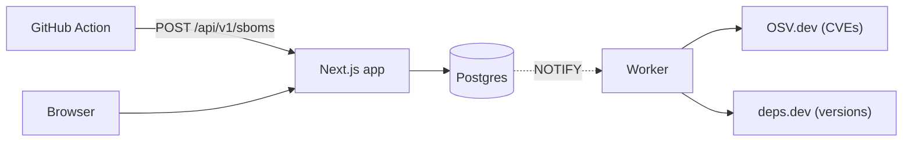

As a developer, my security knowledge has mainly revolved around the OWASP Top 10 and
other training the company suggested. Recently, though, I wanted to expand that knowledge,
partly because I kept seeing LinkedIn posts about newly discovered security flaws. I also
wanted a better idea of my attack surface across the websites and MCP servers I've been
creating. That led me to the Software Bill of Materials (SBOM), and I decided to see what
I could do with it.

## Version one: a list of CVEs

I've been working in Claude Code to create a dashboard where I can upload an SBOM. The
dashboard scans the file against the known CVEs from [OSV.dev](https://osv.dev) and gives
me a breakdown for each application.

That first version worked, but it was immediately overwhelming. A single Node project can
pull in hundreds of packages, and a handful of them will always have _something_ filed
against them. A flat list of every CVE doesn't tell you what to do on Monday morning. I
had learned what was in my software, but not what mattered.

## The question that shaped everything: what do I patch first?

Since then, most of the dashboard has been an attempt to answer that one question.

- **CISA KEV**: vulnerabilities that are known to be exploited in the wild get a chip, a
  sortable column, and a tile on the overview. If it's on that list, it jumps the queue.
- **EPSS**: the estimated probability that a CVE will be exploited in the next 30 days.
  Useful for breaking ties when nothing is on KEV.
- **CVSS**: still there, but it's the last tiebreaker instead of the headline.

The default sort is now KEV, then EPSS, then CVSS, and the overview has a "Fix first" list
at the top. Instead of 300 rows, I get a short list I can actually act on.

_Demo data, not my real applications._

## Getting data in

I didn't want to remember to upload files by hand, so the repo doubles as a GitHub Action.
Each of my repos adds a small workflow that generates an SBOM and posts it to the
dashboard on every push. For container images, an input runs a Syft scan so OS packages
(Alpine in my case) get matched against OSV too.

The app and the worker never talk to each other directly. Instead, the app writes the SBOM
to Postgres and fires a `NOTIFY`, and a separate Node worker picks it up and does the
enrichment. The worker also re-scans on a schedule, so a CVE published tomorrow shows up
without anyone uploading anything.

## Beyond CVEs: is this package even healthy?

A package with zero CVEs today can still be a bad bet. Pulling from
[deps.dev](https://deps.dev) gave me three more signals:

- **Outdated**: the latest release, classified as a major, minor, or patch bump.
- **Deprecated or abandoned**: the registry's deprecation flag, plus no release in years.
- **OpenSSF Scorecard**: the score for each package's source repository.

I also store the dependency edges from the SBOM, so for any vulnerable package I can see
the path that pulled it in. That answers the question I kept running into: "I never
installed that, where did it come from?" Usually it's a transitive dependency three levels
down, and the fix is bumping the one direct dependency above it.

## Watching it over time

The worker writes a daily snapshot per project (severity counts, outdated counts,
component counts), and there are trend charts on each app and on the overview. A single
number is a snapshot of anxiety; a line going down is the thing I actually want to see.

## Locking it down

A security tool that is itself sloppy would be embarrassing. It's single-user, so access
is locked to my numeric GitHub ID through GitHub sign-in, and it fails closed in
production by default. Everything is gated except the health checks, the sign-in
endpoints, and the upload route, which uses its own bearer token. On top of that: a CSP
and security headers, a read-only container filesystem with dropped capabilities, and CI
checks for the supply chain (zizmor, actionlint, dependency-review, pinned actions, and
Trivy scanning the release images). It also runs as a non-root user with a liveness
endpoint and graceful worker shutdown, which should make moving it onto my k3s cluster
easier.

## How I use it

Right now I use it to keep an eye on the dependencies of the applications I have deployed.
Each application posts an SBOM through the GitHub Action when I build it, which covers the
packages in my own code.

The images are a separate job. My cluster config lives in a GitOps repo, and a weekly
workflow there lists every container image the cluster deploys, runs Syft against each
one, and uploads the resulting SBOM to the dashboard. A lot of exposure lives in the base
image and OS packages rather than in my own code, and this is how it shows up. Because the
worker re-scans on a schedule, a CVE published after an image was built still gets
flagged.

My routine is low-key: I check in every few days, start with the "Fix first" list, and
only dig deeper if something new has landed at the top.

## What's next

Things I'm considering but haven't built: time-to-fix and SLA tracking, license policy,
end-of-life runtimes, base-image age, and Slack or email notifications. I'd also like to
write about the other half of this project, which is how I set it up so coding agents can
pick the work up across sessions.
